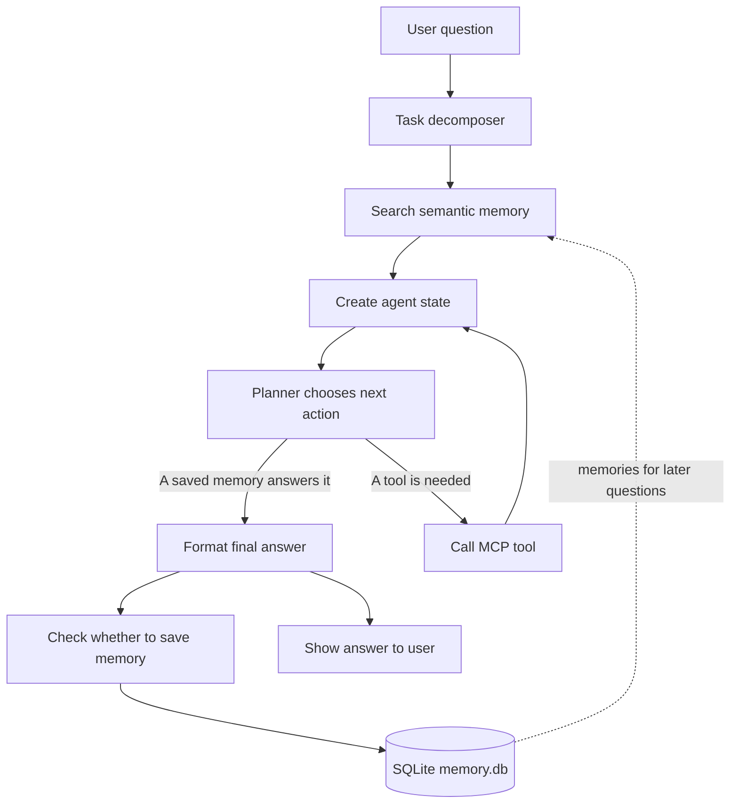

# Autonomous AI Agent with Persistent Memory

## What is this project?

This project is a basic autonomous AI agent. You can ask it a question in the terminal. It can look for a useful answer in saved conversations, break the request into steps, and use tools from an MCP server when needed. It then prepares a clear answer and can save the conversation for future use.

The project uses Groq for its language model and Sentence Transformers to compare questions with saved memories. Its local MCP server provides tools to get the current time, roll a die, and generate a password.

## Learning outcomes

- Understand how an AI agent can keep and retrieve useful memories.
- See how a request can be broken into smaller tasks.
- Learn how an agent can choose actions based on its current state.
- Connect an agent to tools through the Model Context Protocol (MCP).
- Store and search conversation memories using embeddings and SQLite.
- Combine tool results and memory into a final answer.

## Basic architecture



The decomposer suggests the tasks for a question. The agent searches saved conversations and puts the question, tasks, available tools, and memories into its state. The planner looks at that state and either finishes with information from memory, selects an MCP tool, or finishes when no tool is needed. The formatter writes the final answer. The memory extractor decides whether the conversation should be saved in `memory.db` for later semantic search.

## Run locally

### Requirements

- Python 3.12 or later
- [uv](https://docs.astral.sh/uv/) for installing the project dependencies
- A Groq API key and a Groq model name
- A Sentence Transformers model name for embeddings

### Setup

1. Open a terminal in the project folder.
2. Create a local environment file named `.env` with these settings:

   ```dotenv
   GROQ_API_KEY=your_groq_api_key
   GROQ_MODEL_NAME=your_groq_model_name
   EMBEDDING_MODEL=your_sentence_transformers_model_name
   ```

   Replace the example values with your own settings. Keep your real API key private and do not commit `.env` to version control.

3. Install the dependencies:

   ```bash
   uv sync
   ```

4. Start the agent:

   ```bash
   uv run python runner.py
   ```

The program connects to the MCP server in `mcp_config/server.py`, discovers its tools, and creates `memory.db` in the project folder when it starts.

Type `exit`, `bye`, or `quit` to leave the program.

## Example workflow

You ask:

```text
What time is it?
```

The agent breaks the question into a task, checks whether a related conversation is already saved, and gives the planner the current agent state. If a saved memory answers the question, the planner can finish using that information. Otherwise, it can choose the MCP `current_time` tool. The tool result is added to the agent state, the formatter writes a simple answer, and the memory extractor checks whether the conversation is useful to save. The agent then prints the answer in the terminal.
